# Setup Elasticsearch and Kibana on IBM Cloud

## Architecture



## Create Database for Elasticsearch service

Create an instance of this service: [https://cloud.ibm.com/databases/databases-for-elasticsearch/create](https://cloud.ibm.com/databases/databases-for-elasticsearch/create)

## Deploy Kibana on IBM Code Engine

Use the following instructions to deploy Kibana as a container on IBM Code Engine:<br />
[https://cloud.ibm.com/docs/databases-for-elasticsearch?topic=databases-for-elasticsearch-kibana-code-engine-icd-elasticsearch](https://cloud.ibm.com/docs/databases-for-elasticsearch?topic=databases-for-elasticsearch-kibana-code-engine-icd-elasticsearch)

## Add users to Kibana

Two Ansible roles are provided to manage Kibana users against an IBM Cloud Databases for Elasticsearch cluster:

| Role | Purpose |
|------|---------|
| [`ansible-roles/kibana-users`](ansible-roles/kibana-users/) | Creates numbered Kibana users with developer permissions |
| [`ansible-roles/kibana-users-cleanup`](ansible-roles/kibana-users-cleanup/) | Removes those users and the associated custom role |

### Install dependencies

Ansible and `openpyxl` (used by [`kibana_credentials.py`](kibana_credentials.py) to read and write the Excel file with the student credentials) are part of the root [`pyproject.toml`](../pyproject.toml). Install them with [uv](https://docs.astral.sh/uv/getting-started/installation/) from the repository root:

```bash
uv sync
```

Run all commands below with `uv run` (e.g. `uv run ansible-playbook …`) or activate the environment first (`source .venv/bin/activate`).

### Download CA certificate

Download the IBM Cloud Databases CA certificate and save it as `ibm-cloud-databases-ca.pem` in this directory:

- **Via IBM Cloud Console**: Deployment > **Manage** > **Endpoints** > **TLS certificate** > Download certificate.
- **Via CLI**:
  ```bash
  ibmcloud cdb deployment-cacert <deployment-name-or-crn> --save
  mv <downloaded-file> ibm-cloud-databases-ca.pem
  ```

### Configure connection details

Edit [`ansible-roles/kibana-users/defaults/main.yml`](ansible-roles/kibana-users/defaults/main.yml) with your cluster's connection details:

```yaml
elasticsearch_host: "<your-hostname>.databases.appdomain.cloud"
elasticsearch_port: <port>
elasticsearch_protocol: "https"
elasticsearch_admin_user: "<your-admin-user>"
elasticsearch_admin_password: "{{ lookup('env', 'ES_ADMIN_PASSWORD') }}"
```

The admin password is read from the `ES_ADMIN_PASSWORD` environment variable to avoid storing credentials in plain text:

```bash
export ES_ADMIN_PASSWORD="your-admin-password"
```

### Generate individual passwords

Every user gets its own random password and user name. Both are stored in the Excel workbook with the student contacts (sheet `Contacts`, one row per student). The workbook must have an `Email` column — the script aborts with an error if it is missing:

```bash
uv run python kibana_credentials.py generate /path/to/students.xlsx
```

This adds the columns `Password` and `Kibana User` (if missing) and fills empty cells: a random 16 character password and `kibana_user<N>` (N = row order). Existing values are kept; use `--regenerate-passwords` to replace the passwords, `-o` to write to a different file, `--sheet` / `--prefix` to change the sheet name / user prefix.

You can also edit the `Kibana User` column manually. A cell that only contains a number (e.g. `3`) is expanded to `kibana_user3`.

> The workbook contains plaintext passwords. Keep it private, never commit it (`*.xlsx` is git-ignored) and send each student only their own password.

### Create users

The playbook reads the `Kibana User` and `Password` columns from the same workbook and creates one Elasticsearch user per row. Run it from the `setup_ibm-cloud` directory:

```bash
uv run ansible-playbook playbook-create.yml -e kibana_users_excel=/path/to/students.xlsx
```

If the path contains spaces, pass the variable as JSON, because Ansible splits the `key=value` form on whitespace:

```bash
uv run ansible-playbook playbook-create.yml -e '{"kibana_users_excel": "../../Data Engineering/HSLU_Student_Contacts_HS-2026.xlsx"}'
```

Optional variables (see [`ansible-roles/kibana-users/defaults/main.yml`](ansible-roles/kibana-users/defaults/main.yml)): `kibana_users_sheet` (default `Contacts`), `kibana_user_prefix` (default `kibana_user`), `kibana_user_role_name` (default `kibana_developer`).

On success, Ansible prints a summary of the created users:

```
"=========================================="
"IBM Cloud Kibana Access Information"
"=========================================="
"Users created: 20"
"Users: kibana_user1, kibana_user2, …"
"Passwords: individual per user (see column 'Password' in the Excel file)"
"=========================================="
"IMPORTANT: Users should change their password on first login!"
"=========================================="
```

### Delete users

To remove all users and the custom role created above, run:

```bash
uv run ansible-playbook playbook-delete.yml
```

The cleanup role will discover every user matching `kibana_user_prefix`, prompt for confirmation, then delete the users and the `kibana_developer` role. To skip the confirmation prompt, pass the variable on the command line:

```bash
uv run ansible-playbook playbook-delete.yml -e "confirm_deletion=false"
```
